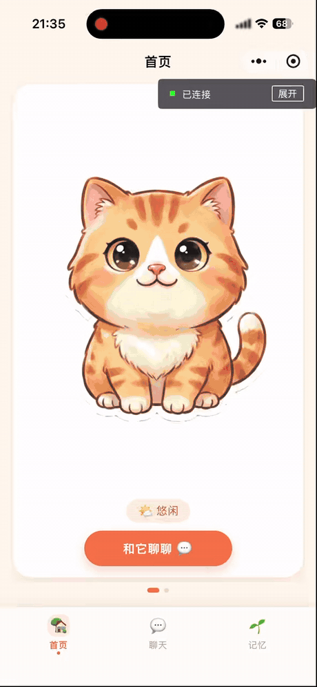
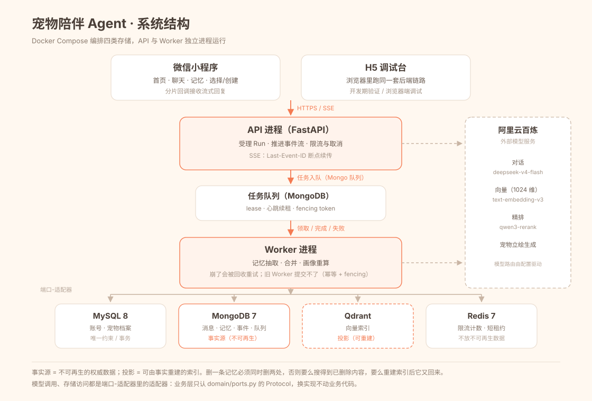

# 宠物陪伴 Agent · 有长期记忆的微信小程序

微信小程序 + Python 后端。这里的 Agent（智能体：由模型驱动、按固定流程完成一轮任务的程序）围绕一条完整的长期记忆链路：把用户原话沉淀为可溯源的事实，按宠物隔离，支持纠正与删除；对话以流式输出，记忆抽取与画像更新交给可恢复的后台任务。

---

## 目录

- [一、项目概览](#一项目概览)
- [二、界面](#二界面)
- [三、系统结构](#三系统结构)
- [四、一次对话的执行链路](#四一次对话的执行链路)
- [五、长期记忆](#五长期记忆)
- [六、混合检索](#六混合检索)
- [七、可靠异步](#七可靠异步)
- [八、流式交付](#八流式交付)
- [九、流量治理](#九流量治理)
- [十、工程架构与质量](#十工程架构与质量)
- [十一、技术栈](#十一技术栈)
- [十二、指标](#十二指标)
- [十三、文档](#十三文档)

---

## 一、项目概览

用户打开小程序 → 微信登录 → 选择预设宠物「团子」或创建一只自定义宠物 → 进入聊天。再次进入时恢复上次选择的宠物；每只宠物拥有独立的记忆域与对话上下文。

### 核心不变量

| 不变量 | 实现 |
| --- | --- |
| 记忆按 `pet_id` 隔离 | 检索前在 Qdrant payload 与 BM25 语料范围上过滤，不在应用层事后剔除 |
| 一人一宠一段会话 | 会话身份由 `(user_id, pet_id)` 唯一确定，每只宠物一条连续会话 |
| AI 只提议 | 模型输出提议（Proposal：模型给出、尚未被系统接受的候选动作），由 `settle()` 结算成提交计划（CommitPlan：一次对话最终要执行的副作用清单） |
| 终态不可逆 | 一次对话运行（Run：从受理到终态的执行记录）到达 `succeeded / failed / cancelled` 后不再变化 |
| 副作用幂等 | 每个副作用（Effect：写库、建索引等对外部世界的改变）都带幂等键（`idempotency_key`：同一个键重复执行只生效一次） |

---

## 二、界面



宠物「团子」的四种表情立绘（文生图模型生成；触摸时切换表情，纯前端动画，不调后端）：


四个页面，底部 tab 切换，每页一屏：

| 页面 | 内容 |
| --- | --- |
| 首页 | 两只宠物的大卡片左右滑动切换；立绘可触摸，纯前端动画反馈；未创建时第二张是「＋自定义」入口 |
| 聊天 | 微信式布局；回复逐字流出；键盘弹起不顶页面 |
| 记忆 | 两只宠物两张独立大卡；每条记忆展示内容与时间，可纠正 / 删除 |
| 选择 / 创建 | 预设「团子」一键开始，或上传照片走对话式创建 |

---

## 三、系统结构



| 组件 | 职责 |
| --- | --- |
| 微信小程序 | 4 个页面；用 `wx.request` 的分片回调接收流式回复 |
| H5 调试台（网页调试客户端） | `/demo`：复用同一套 API 与事件流的浏览器页面 |
| API 进程（接口服务） | FastAPI：受理 Run、推进事件流、限流与取消 |
| Worker 进程（后台任务进程） | 后台慢活：记忆抽取、冲突消解、画像重算，不阻塞用户回复 |
| MySQL 8 | 账号、宠物档案 |
| MongoDB 7 | 会话消息、记忆事实、事件日志、任务队列 —— 事实源 |
| Qdrant | 向量索引 —— 可重建投影 |
| Redis 7 | 限流计数、短期运行状态 |
| 阿里云百炼 | 对话 / 向量（1024 维）/ 精排 / 立绘生成 |

**事实源与投影分离**：MongoDB 保存权威记录，Qdrant 只保存可由事实重建的索引。删除一条记忆时，权威记录与向量投影必须同时清理；索引丢失时，可以从事实源重建。这条约束决定了"删除"是否真的生效。


### 3.1 身份与数据隔离

`wx.login()` 只产出一枚一次性 `code`（临时登录码，5 分钟内有效且只能使用一次）。后端用 AppID + secret 调用微信 `jscode2session` 换取 `openid`，映射为内部 `user_id`，再签发 HMAC-SHA256（带密钥的哈希签名：客户端改内容后算不出新签名）保护的 Bearer Token（持有者令牌：客户端每次请求携带的身份凭证，默认 7 天有效）。令牌只包含 `user_id`、签发时间与过期时间，不携带 `openid`；服务端验签并校验过期后才进入业务层。

所有面向用户的资源查询都带 `user_id`，并在仓储层校验归属；归属不匹配时统一按不存在处理。当前宠物指针持久化在用户记录上，进入时恢复"最后聊的那只"；写入与检索都以 `pet_id` 为作用域，记忆不会跨宠物混用。

---

## 四、一次对话的执行链路

```
load_context → retrieve → actor → validate → settle
```

| 节点 | 职责 | 产出 |
| --- | --- | --- |
| `load_context` | 组装宠物人设、近期消息窗口、相关记忆，受 token（模型处理文本的最小计量单位）预算约束 | 上下文包 |
| `retrieve` | 混合检索相关资料与长期记忆 | 带分数的候选与出处 |
| `actor` | 模型生成回复，并输出结构化的记忆提议 | 回复文本 + Proposal |
| `validate` | 校验提议的字段、归属范围、引用合法性 | 合法提议 |
| `settle` | 用确定性规则结算提议 | CommitPlan |

`settle` 是纯函数：相同输入永远得到相同的计划，不读写任何外部系统。它带来三个直接能力：离线单测、精确回放、事后审计。

Run 创建带 `client_request_id`，仓储层唯一索引保证同一条消息重发不会产生第二个 Run。每个 Proposal 携带 `generation`（代次：同一条消息被重新生成时的版本号），`settle` 校验代次，旧代次结果整体拒绝。

每个 Run 在创建时冻结版本四元组（VersionTuple：流程版本、提示词版本、模型路由版本、索引版本的组合）；每个节点写入带自增 `seq` 的 NodeEvent。最终任何一条回复都能回答"当时用的是哪版流程、哪个模型、哪版资料"。

---

## 五、长期记忆

### 5.1 数据分层

| 实体 | 含义 | 关键性质 |
| --- | --- | --- |
| Episode | 用户说过的原话 | 只追加，永不改写，是所有结论的证据 |
| Fact | 从原话抽出的原子事实 | 可被支持、反驳、失效，不靠覆盖表达变化 |
| Profile | 按稳定维度合并出的画像 | 可重新计算，不承担权威性 |
| Provenance | 出处：每条结论对应的原始对话证据 | 任意结论都能反查到原话 |
| Index Projection | 向量 / 关键词索引 | 可删除、可重建，不是事实 |

链路：`Episode → 抽取 → Fact → 合并 → Profile`，每一跳都保留溯源。

### 5.2 抽取：结构化输出 + 约束收敛

1. 模型输出结构化候选事实，而不是自由文本。
2. 归属收敛：`objective`（客观世界）事实的 owner 固定为 `world`；`subjective`（主观）事实只能归属当前 `user_id` / `pet_id`。
3. 内容长度上限 80 字符，字段缺失或越界的条目直接丢弃。
4. 部分成功：合法条目继续提交，非法条目不会让整批失败。

### 5.3 冲突消解：规则优先，模型只做语义判断

候选事实与已有事实的关系被约束在五个标签内：

`NEW`（新事实）· `DUPLICATE`（重复）· `SUPPORTS`（支持）· `REFUTES`（反驳）· `UPDATES`（更新）

执行顺序：

1. 完全一致的文本先用确定性规则判为 `DUPLICATE`。
2. 其余交给模型分类，但 `target_fact_id` 必须来自候选白名单。
3. 模型编造不存在的 ID → 降级为 `NEW`。
4. 模型调用失败 → 整批降级为 `NEW`，避免丢失事实。

关系落库是追加式的：新增支持边、反驳边或失效标记，不覆盖历史原话。

### 5.4 画像：引用校验 + 版本并发控制

画像按 `identity`（身份）· `preferences`（偏好）· `relationship`（关系）三个维度生成。每条摘要必须引用真实存在的 `fact_ids`；引用不存在的事实会被判为幻觉并拒绝写入。画像带 `version`，写入时使用 CAS（Compare-And-Swap，比较并交换：带上读到的版本号，版本不一致就拒绝），避免两个 Worker 互相覆盖。画像与事实之间写入 `summarized_into` 边，保留合并来源。

### 5.5 纠正与删除

- **纠正**：写一条反驳事实，原事实状态变为"被反驳"，画像重算后自然变化，历史仍然保留。
- **删除**：同时删除 MongoDB 权威记录与 Qdrant 投影。两步都可重试、可对账；只删一处会造成"搜得到已删除内容"或"重建索引后数据复活"。
- **隔离**：每只宠物有独立记忆域，检索范围在召回前收窄到当前 `pet_id`，一只宠物的记忆不会进入另一只的上下文。

---

## 六、混合检索

| 阶段 | 做法 | 关键参数 |
| --- | --- | --- |
| 查询变体 | 原句 + 去标点版本，最多 3 个 | `max_queries=3` |
| Dense（稠密向量：把文本压成固定维度数字，语义相近则距离近） | Qdrant 向量检索，每个变体各召回一批 | 每路 30 条 |
| Sparse（稀疏关键词：按词是否出现及权重表示文本） | BM25（经典关键词相关性打分，综合词频、逆文档频率与文档长度） | 30 条；`k1=1.5`、`b=0.75` |
| 融合 | RRF（Reciprocal Rank Fusion，倒数排名融合：只用名次换算分数再相加） | `k=60` |
| 精排 | Rerank（用更强的相关性模型对候选逐条重新打分） | 前 40 条候选；模型 `qwen3-rerank` |
| 输出 | 记忆召回默认取前 5 条 | `limit=5` |

中文 token 使用字符二元组，避免依赖分词词典。RRF 公式：

```
RRF(d) = Σ 1 / (60 + rank_i(d))
```

两路召回使用不同量纲的分数，直接相加没有意义；RRF 只使用名次，天然可比。精排失败或超时时降级回 RRF 顺序，对话链路不因精排不可用而失败。

**隔离发生在召回前**：Dense 在 Qdrant 侧按 `pet_id / user_id / status` 过滤；Sparse 只在当前范围的 active 事实上打分。不会出现"先全库召回、再在 Python 里筛掉别的宠物"。

---

## 七、可靠异步

回复发出后，记忆抽取、冲突消解、画像重算由 Worker 异步执行。任务队列存放在 MongoDB，状态机如下：

```
pending ──claim──> running ──complete──> done
                      │
                      ├──fail（可重试）──> pending（退避后重试）
                      └──fail（不可重试）──> dead
```

| 机制 | 作用 |
| --- | --- |
| 幂等键唯一索引 | 同一业务动作只入队一次；重复提交被数据库挡住 |
| Lease（租约：领取任务时获得的限时工作凭证） | Worker 崩溃后任务不会永久停在 running |
| Heartbeat（心跳续租） | 按租约一半周期续期，区分"还在干活"与"已经死了" |
| Fencing Token（栅栏令牌：每次领取生成的新编号） | complete / fail / renew 都校验当前 token，旧 Worker 复活后无法提交 |
| Reconcile（对账：定期扫描超时任务并重新入队） | 兜底回收过期 running 任务 |
| Effect 幂等键 | 每个副作用独立幂等，重试不会做两遍 |

租约、心跳、栅栏令牌三者同时存在，才构成"崩溃可恢复、结果不重复"的闭环。只有租约没有栅栏令牌时，旧 Worker 与新 Worker 可能同时认为自己有权提交。

---

## 八、流式交付

```
POST /v1/runs              → 202 { run_id }
GET  /v1/runs/{id}/events  → text/event-stream
```

SSE（Server-Sent Events：服务器通过一条 HTTP 连接持续向下推送事件）事件带自增 `id`。客户端断线后携带 `Last-Event-ID` 重连，服务端从断点续传。

客户端解析器处理三类异常输入：

| 情况 | 处理 |
| --- | --- |
| 半包：一个事件被网络切成两段 | 维护文本缓冲，只在空行（事件分隔符）处切帧 |
| 中文跨片：一个汉字 3 字节，可能切在中间 | 使用流式 UTF-8 解码器，不完整的尾部字节留到下一片 |
| 心跳注释：`: ping` | 识别注释行并忽略，不当作事件解析 |

重连采用指数退避（`400ms × 重试次数`，上限 2.5 秒）；收到真实事件后重试计数清零；401 先刷新登录态再重连。客户端断开 SSE 不等于任务取消，取消通过 `POST /v1/runs/{id}/cancel` 显式发起。

---

## 九、流量治理

- **令牌桶（Token Bucket：按固定速率补充令牌，请求消耗令牌，允许短时突发）**：Agent 流量天然突发，令牌桶既能吸收突发，又有总量上限。
- **429 + `Retry-After`**：超限时明确告诉客户端等待多久，避免无脑重试造成雪崩。
- **取消语义**：取消是"请求停止"，正在执行的模型调用不一定能瞬间中断，但会在下一个可中断点退出，并且不再执行后续副作用；事件流会明确标记本次以取消结束。
- **背压（Backpressure：下游处理不过来时主动拒绝，而不是无限排队）**：连接数与在途任务数都有上限，超过即拒绝，避免排队耗尽内存。

---

## 十、工程架构与质量

### 10.1 端口-适配器

`domain/ports.py` 定义全部 Protocol（协议：只描述能力、不绑定实现的接口约定）。业务层只依赖 Protocol；MySQL、MongoDB、Qdrant、Redis、百炼分别由独立适配器实现。测试中使用内存实现，绝大多数用例不需要启动容器。

模型接入同样走端口：对话、向量、精排是三个独立适配器，模型名与路由由配置驱动，替换模型不影响业务层。

### 10.2 确定性优先

- 能用确定性规则解决的，不交给概率模型。
- 必须由模型做的语义判断，把答案空间约束到固定标签或固定 schema（字段结构）。
- 模型失败时有明确的降级路径，不把"模型不可用"扩散成"整条链路失败"。

### 10.3 版本与审计

- Run 创建时冻结 VersionTuple。
- 每个节点写入 NodeEvent（`seq` / `node` / `type`）。
- 每个副作用携带幂等键。
- 任务状态迁移保留 lease token 与失败原因。

### 10.4 存储职责

| 存储 | 数据 | 丢失后的后果 |
| --- | --- | --- |
| MongoDB | 消息、事实、事件、队列 | 权威数据丢失，不可再生 |
| Qdrant | 向量索引 | 可从事实重建 |
| MySQL | 账号、宠物档案 | 权威数据丢失，不可再生 |
| Redis | 限流计数、短期状态 | 可重建，不影响事实 |

### 10.5 质量基线

| 项 | 结果 |
| --- | --- |
| 自动化测试 | 133 项通过（单元 + 真实 MySQL / MongoDB / Qdrant 集成） |
| 静态检查 | ruff（src / tests / apps）全通过 |
| HTTP 接口 | 18 个（8 组，含 1 条 SSE 事件流） |
| 对话图节点 | 5 个 |

---

## 十一、技术栈

| 层 | 选型 |
| --- | --- |
| 语言 | Python 3.12 |
| Web | FastAPI + Uvicorn |
| 编排 | LangGraph（`load_context → retrieve → actor → validate → settle`） |
| 存储 | MySQL 8.4 · MongoDB 7 · Qdrant · Redis 7 |
| 模型 | 阿里云百炼：`deepseek-v4-flash-0731`（对话）· `text-embedding-v3`（1024 维向量）· `qwen3-rerank`（精排）· `qwen-image-2.0`（立绘生成） |
| 客户端 | 微信小程序（原生，4 页）+ H5 调试台 |
| 质量 | pytest · ruff |

---

## 十二、指标

| 项 | 数值 |
| --- | --- |
| 自动化测试 | 133 项通过 |
| 静态检查 | ruff（src / tests / apps）全通过 |
| HTTP 端点 | 18 个（8 组，含 SSE） |
| 对话图节点 | 5 个 |
| 存储 | 4 类（MySQL / MongoDB / Qdrant / Redis） |
| 宠物 | 2 只（1 预设 + 1 自定义，各自独立记忆） |

---

## 十三、文档

| 文档 | 内容 |
| --- | --- |
| [docs/design-notes.md](docs/design-notes.md) | 记忆流水线、混合检索、可靠异步、流式协议、流量治理 |
| [docs/domain-model.md](docs/domain-model.md) | 核心对象与三条硬规则 |
| [docs/architecture.svg](docs/architecture.svg) | 系统结构图源文件 |
