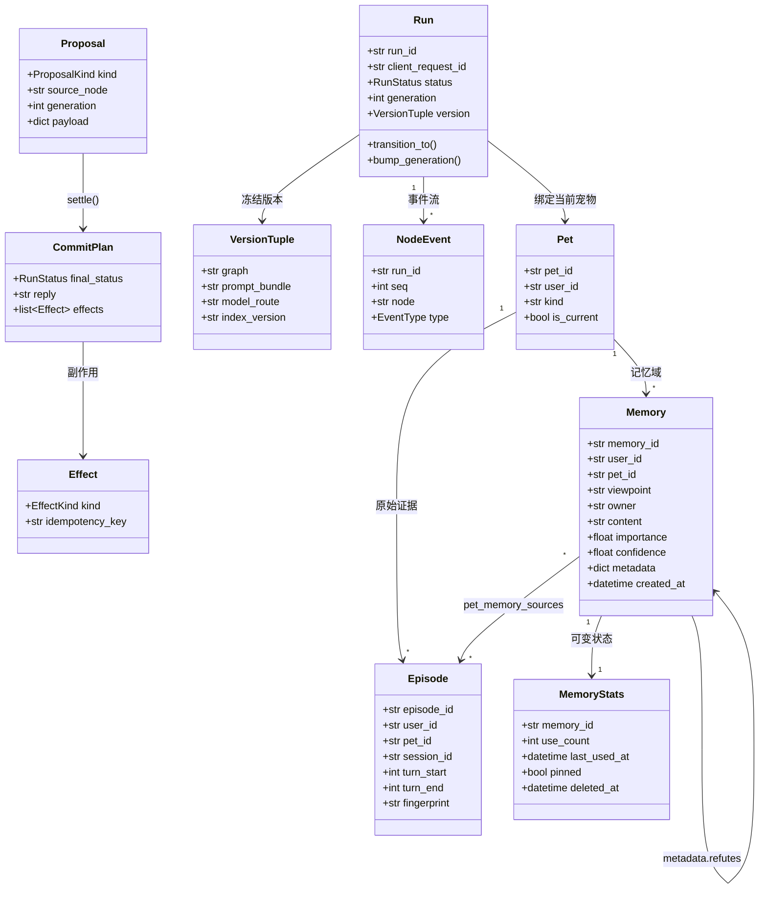

# 领域模型

一页看懂核心对象、三条硬规则与记忆层的三条不变量。记忆流水线、检索与可靠性细节见 [design-notes.md](design-notes.md)。

## 三条硬规则

1. **AI 只提议**：Proposal 不是结果，必须经 `settle()` 校验后才产生 CommitPlan。
2. **终态不可逆**：Run.status 到达 `succeeded / failed / cancelled` 后永不再变。
3. **副作用带幂等键**：每个 Effect 都有 `idempotency_key`，重试不会做两遍。

## 记忆层的三条不变量

1. **Memory 只追加**：旧记录一个字段都不改；变化用新 Memory + `metadata.refutes` 表达，时间线始终完整。
2. **三条泳道各自消解**：`__world__`（客观）/ `user`（主人主观）/ `pet:<id>`（宠物主观）不跨泳道比较；主观记忆用 `metadata.objective_memory_ids` 锚定客观记忆。
3. **出处与本体分开**：`pet_memory_sources` 是 Memory ↔ Episode 多对多；支持数实时 `count`，不单独维护计数列。

## 两个旁路

| 旁路 | 存什么 | 为什么单独放 |
| --- | --- | --- |
| `pet_mem_stats` | `use_count / last_used_at / pinned / deleted_at` | 这些会变，但 Memory 本体不能变 |
| Qdrant | 向量索引 | 可重建；重建时过滤 `deleted_at`，删掉的记忆不会复活 |
