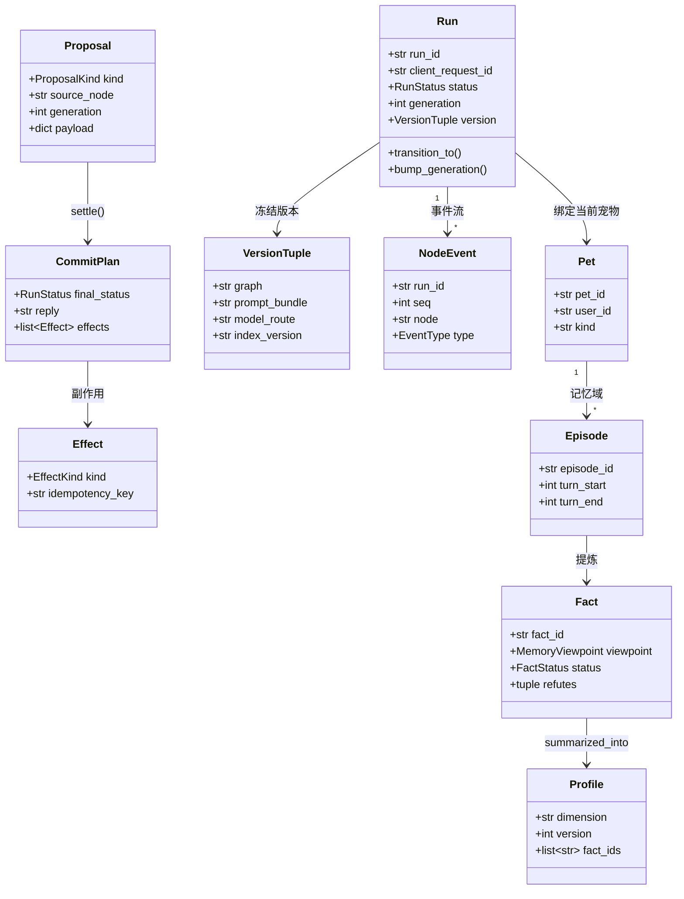

# 领域模型

一页看懂核心对象与三条硬规则。记忆流水线、检索与可靠性细节见 [design-notes.md](design-notes.md)。

## 三条硬规则

1. **AI 只提议**：Proposal 不是结果，必须经 `settle()` 校验后才产生 CommitPlan。
2. **终态不可逆**：Run.status 到达 `succeeded / failed / cancelled` 后永不再变。
3. **副作用带幂等键**：每个 Effect 都有 `idempotency_key`，重试不会做两遍。
